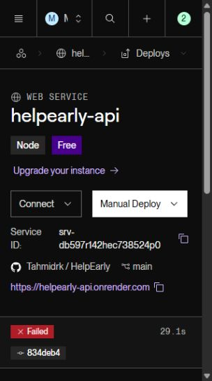

# HelpEarly Render deployment execution report

Updated 2026-10-11. **Backend build passed; backend is not operational.** Existing Vercel and Supabase records remain unchanged. No paid infrastructure was provisioned.

| Check | Actual result |
|---|---|
| Existing Render account access | PASS: signed-in dashboard, existing My Workspace |
| Free service creation | PASS: `helpearly-api`, `srv-db597r142hec738524p0`, Oregon, Node, Free $0, no disk/database/card |
| Source | Owner-authorized fork [Tahmidrk/HelpEarly](https://github.com/Tahmidrk/HelpEarly), `main`, application commit `834deb43a6a64710955110ead773036133d93388` |
| Hosted build | PASS: Node 22.14.0, root `server`, `npm ci --omit=dev`, 138 packages installed, audit 139 packages / zero vulnerabilities |
| Startup | FAIL: `npm start` exits 1 with “Production requires DATABASE_URL and persistent Supabase Storage” |
| Public health/readiness | GET `/api/health` and `/api/ready`: both timed out after 20 seconds; no successful JSON obtained |
| Render-to-Supabase connection | BLOCKED: actual PostgreSQL password/complete private URL unavailable |
| Public CORS | OPTIONS `/api/auth/login` with existing Vercel Origin timed out; not verified live |
| Public Socket.IO | GET `/socket.io/?EIO=4&transport=polling` timed out; live authentication/reconnect/WSS not verified |
| Production schema/media | NOT APPLIED: 13 existing tables; current app requires 22 tables/schema 2 and a private media bucket |
| Vercel release | NOT CHANGED: original website/project retained; previous audit found an obsolete Railway API URL |
| Android release | Local Hermes export passed previously; physical device, signed APK/AAB and live FCM pending |
| Branding | Deferred until operational completion and explicit owner approval |

Service URL: [https://helpearly-api.onrender.com](https://helpearly-api.onrender.com). Dashboard: [existing service](https://dashboard.render.com/web/srv-db597r142hec738524p0). Failed attempt: `dep-db597r942hec738525t0`, 2026-10-11 01:37:17 Bangladesh time, build succeeded then runtime failed. A public URL or successful build does not imply a working API.

## Configuration and safe fixes

The service uses `NODE_ENV=production`, verified database TLS, `DB_POOL_MAX=5`, `CLIENT_URL=https://atyour-service.vercel.app`, Supabase storage provider, existing project URL, private bucket name `helpearly-media`, request logging, proxy trust 1 and the database-backed worker. Render supplies PORT. JWT_SECRET was generated privately using Render's native generator; its value was not printed or committed. Push stays disabled until Expo/FCM credentials are configured. `/api/ready` is the health check; auto-deploy and PR previews are off.

Private `DATABASE_URL` and `SUPABASE_SERVICE_ROLE_KEY` are required; optional AI credentials also need provider configuration for live AI answers. No dummy credentials, public media fallback, schema marker bypass or automatic production migration was added. After the owner signed in to Supabase, its existing service-role key was saved directly into ignored `server/.env.audit` without printing it. A read-only Storage bucket-list request using that credential passed (HTTP 200, zero buckets). The key has not been configured in Render yet; live uploads remain unverified. Signed-in dashboard and connector access do not reveal the existing PostgreSQL password. The owner supplied the session-pooler host `aws-1-ap-northeast-1.pooler.supabase.com`, port 5432 and user `postgres.gjwkrqlzroujlueexcxc`; the dashboard confirms that template, but `[YOUR-PASSWORD]` is not a usable connection secret.

Expired Git authentication was renewed through Git Credential Manager. The owner-authorized fork contains the combined web/mobile/backend history. Local `origin` now points to the owner's fork; `upstream` points to the original repository. Original repository `main` was not pushed or replaced. Node runtime was selected instead of Render's initial Docker autodetection; the service was explicitly switched from its paid default to Free before creation. `render.yaml` now matches the actual service name and safe TLS/origin settings. Reuse this service; do not create a second Blueprint service.

## Database approval and preservation gate

The owner approved the exact reviewed schema migration, RLS/direct Data API grant remediation and one private bucket **after verified production backup and isolated restore**. See [reviewed scope and source hashes](SUPABASE_RELEASE_APPROVAL.md). This condition remains unsatisfied; nothing was applied live. No production backup has been verified. The signed-in project overview reports “No backups”; that is not evidence of recoverable production data elsewhere.

Fresh read-only catalog comparison matched the isolated test fixture exactly: 13 tables, 109 columns, 49 constraints. Counts were users 31, helpers 22, bookings 10, jobs 12, messages 27, reviews 5, complaints 2; zero Storage buckets/objects. Existing records were neither copied nor modified. All 13 tables had RLS disabled and anon grants; approved remediation remains pending the backup gate.

Private credentials belong in ignored `server/.env.audit` and Render environment settings, not source or client bundles. Keep development `server/.env` unchanged. Before any live migration, take a fresh PostgreSQL dump over verified TLS and restore into an isolated local database. Verify records/relationships, source hashes and counts. Since no Storage bucket exists yet, document the empty production media inventory rather than mislabeling local uploads as production media or creating a bucket before the gate is satisfied.

## Remaining release actions

1. Supply the existing PostgreSQL password privately. The existing server storage key has been saved privately and its read-only access verified. Do not reset credentials automatically.
2. Complete fresh production backup and isolated restore. Apply only the conditionally approved migration/security/bucket scope, verify preservation and schema 2, then verify private Storage behavior.
3. Configure real private secrets on the existing Render service and redeploy. Require working health/readiness, database persistence, authenticated Socket.IO, CORS, uploads and database-backed MVP workflows before treating deployment as successful.
4. Prepare the existing Vercel project's `VITE_API_URL=https://helpearly-api.onrender.com`; optional `VITE_SOCKET_URL` can use the same origin. Obtain the separate required live Vercel redeployment approval before changing that production project. Prepare Android `EXPO_PUBLIC_API_URL` with the same verified HTTPS origin; preserve the current UI.
5. Complete paired real Android/Web workflows, signing/EAS/FCM setup and live push checks. Record pending checks honestly. Continue the separate branding phase only after its explicit approval.

Previous local evidence: [database/security/sync results](test-results/free-stack.json), [feature parity and Android visual preservation](FEATURE_PARITY.md), [architecture, demonstration fallback and commercial upgrade path](FREE_STACK_STRATEGY.md). Mock Storage/provider tests and protocol tests do not establish live Storage, push or physical-device success.

Source backup: `H:\apps\HelpEarly-backups\helpearly-render-834deb4.bundle`, verified complete Git history. Earlier local database/media backup `H:\apps\HelpEarly-backups\helpearly-2026-10-10T17-46-09-722Z` passed isolated restore. Neither is a backup of live Supabase records. Keep private environments, signing credentials and actual production backups outside Git.

Free-host limits and setup: [Render Free](https://render.com/docs/free), [Express deployment](https://render.com/docs/deploy-node-express-app), [health checks](https://render.com/docs/health-checks). A sleeping Free service or temporary supervised tunnel is acceptable for demonstration; neither guarantees commercial uptime.
