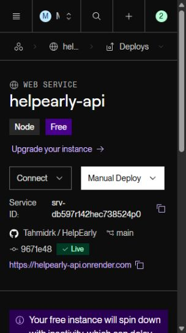
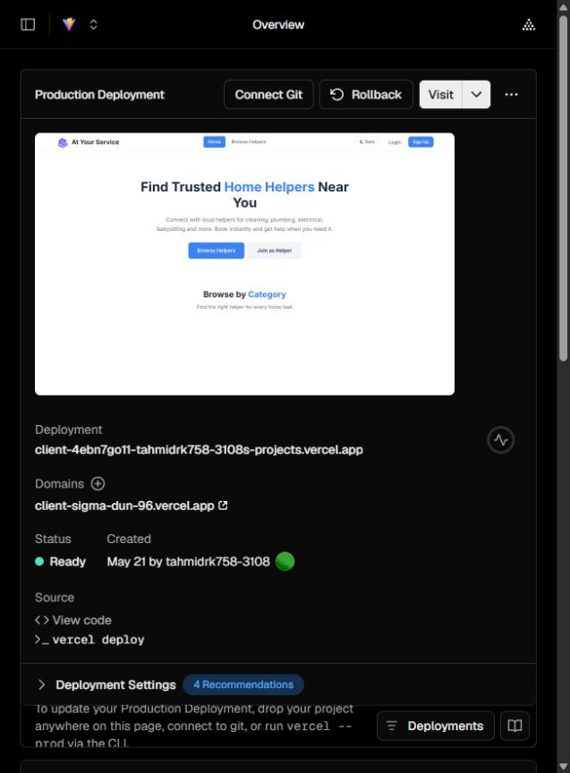

# HelpEarly Render deployment execution report

Updated 2026-10-11. **Render Free backend is live and tested.** Existing Supabase data was preserved through the approved migration. Existing Vercel website has not been redeployed; deployment is approved and access to the Vercel account owning atyour-service.vercel.app remains pending. No paid service, disk, new database or payment card was added. Android visuals are unchanged.

| Check | Actual result |
|---|---|
| Existing Render account | PASS: existing My Workspace, authenticated dashboard |
| Service | LIVE: `helpearly-api`, `srv-db597r142hec738524p0`, Node, Oregon, Free $0 |
| Source | Owner-authorized [Tahmidrk/HelpEarly](https://github.com/Tahmidrk/HelpEarly) fork, `main`, application deployment commit `9671e4862820df85bce27a1a91f53c278186e7b1` |
| Hosted build | PASS: Node 22.14.0, root `server`, `npm ci --omit=dev`, 138 packages installed, audit 139 / zero vulnerabilities |
| Startup | PASS: production `npm start`, port 10000, PostgreSQL schema and private Storage checks passed |
| Health/readiness | PASS: HTTP 200 `{status:"ok",database:"connected"}` and `{status:"ready",schema:2}` |
| Supabase connection | PASS: existing Tokyo project, session pooler 5432, verified TLS using official Supabase CA |
| CORS | PASS: existing Vercel origin preflight HTTP 204 and correct allow-origin; untrusted origin gets no CORS permission |
| Authentication/Socket.IO | PASS: tokenless REST denied, normal login/role guards work, actual external authenticated WSS connects; missing token and untrusted socket origin rejected |
| Production schema/media | PASS: owner-approved schema 2/22 tables, RLS/direct grant remediation and private bucket; original records preserved |
| Vercel release | APPROVED, PROJECT ACCESS PENDING: existing website retained; latest production build with the Render origin passed |
| Android | PASS: clean Hermes export contains Render URL; real API-module pairing passed. Signed APK/AAB, physical phone and FCM remain pending |
| Branding | Deferred until operational completion and explicit owner approval |

Service: [https://helpearly-api.onrender.com](https://helpearly-api.onrender.com). Health: [database health JSON](https://helpearly-api.onrender.com/api/health). Dashboard: [existing service](https://dashboard.render.com/web/srv-db597r142hec738524p0). Successful deploy: `dep-db59lag473hc73aca2og`, 2026-10-11 02:06:02 Bangladesh time, duration 39 seconds.

## Executed external tests

[HTTP evidence](test-results/render-http-live-20261011.json) verifies public health/readiness, tokenless rejection and Vercel CORS. [Live MVP evidence](test-results/render-mvp-live-20261011.json) verifies worker trade selection without fake services/rating/reviews, role guards, dual self-exclusion, admin verification/discovery, booking with offered fee/manual description/photo, authenticated WSS hints, missed-socket recovery, two-way chat/participant isolation, completion/review, photo job/proposal acceptance into booking, complaint resolution and logout/relogin persistence.

The actual Web and Android API modules were compiled and executed against real Render/Supabase endpoints in both directions for profile/services/bookings. Native platform/AsyncStorage bindings were simulated for this protocol test; it is not physical Android or rendered-screen verification. Probe users, their records and photos were removed; every original record fingerprint/count was rechecked against the production backup. A probe harness method-name error was corrected and the complete probe rerun passed; no app business logic was changed.

Client/server configuration checks passed again after the templates were updated. Android preservation initially failed on the intentional production-template API URL change; the check now permits exactly that reviewed line change while retaining every screen/style/navigation/asset/dependency comparison. Its rerun passed all 15 visual modules. No rendered-pixel or physical-device pass is claimed. A read-only legacy media audit found zero `/uploads/` references in existing user avatars, booking photos or job photos; no original media references were rewritten.

[Live Storage evidence](test-results/supabase-storage-live-20261011.json) verifies upload/read byte equality, signed URL retrieval, unsigned public denial, MIME rejection and cleanup. [Data API evidence](test-results/supabase-data-api-security-20261011.json) verifies anonymous users read returns 401. Live emergency broadcast was deliberately not sent to existing workers; emergency/concurrency behavior passed earlier isolated DB/API tests and still needs a supervised live walkthrough. Live push and real AI answers are pending credentials.

## Configuration and safe fixes

Render uses `NODE_ENV=production`, `CLIENT_URL=https://atyour-service.vercel.app`, `DB_POOL_MAX=5`, verified TLS, official `DB_SSL_CA`, Supabase provider/existing project URL/private bucket, request logging, proxy trust 1 and durable database-backed worker. Render supplies PORT. Existing JWT_SECRET remains privately generated and unchanged. Real DATABASE_URL and Storage service-role key were saved only in ignored `server/.env.audit` and approved Render settings; no key/password appears in Git or client bundles. Development `server/.env` remains unchanged. Push stays disabled until Expo/FCM setup. Health is `/api/ready`; auto-deploy/PR previews are off.

Initial deploy `dep-db597r942hec738525t0` built successfully but failed safely because production secrets were absent. After obtaining the owner's existing password, TLS initially reported `SELF_SIGNED_CERT_IN_CHAIN`; the official dashboard CA resolved it without weakening verification. No password reset occurred. The owner then approved saving PostgreSQL/Storage/CA settings on the existing Render service and redeploying. Node was selected instead of initial Docker autodetection, Free replaced the paid default before creation, and the Blueprint was aligned with service name, origin/TLS and CA configuration. Reuse this service rather than creating another.

Local Git `origin` points to the owner's fork; `upstream` points to the original repository. Original repository `main` and its Vercel deployment source were not overwritten. React production artifact is `client/dist/assets/index-BH9vB0Ja.js` and includes the Render origin. Android export is `H:\apps\HelpEarly-test-tools\android-render-export`, Hermes `index-b18cafc124f476fa2a1c80bde15c2d7b.hbc`, verified to include the same origin. The first cached Android export retained the earlier URL; rerunning `expo export --clear` fixed the artifact. Clear Metro cache after changing public build environment values. Hermes export is not an installable APK.

## Backup, approved migration and preservation

Fresh production backup: `H:\apps\HelpEarly-backups\supabase-production-2026-10-10T20-01-10-313Z`. Custom dump scope is all 13 public application tables/data/sequences/routines/triggers/ACL; managed Supabase schemas are excluded because this migration does not change them. Production Storage was empty and its inventory was verified. All original records/foreign keys restored into a newly created local database. The exact reviewed migration passed there before any live change. The initial local restore hit a pre-existing empty public schema; only that newly created empty local target was corrected and a fresh backup/restore rerun passed. No production restore or destructive schema reset was performed.

The exact reviewed migration and private bucket were applied only after the owner's conditional approval gate was satisfied. [Approval scope/source hashes](SUPABASE_RELEASE_APPROVAL.md); [execution evidence](test-results/supabase-production-release-20261011.json). All original counts remain: users 31, helpers 22, bookings 10, jobs 12, messages 27, reviews 5, complaints 2, conversations 4, categories 10, helper categories 31, helper services 40, job applications 3, payments 4. Original records match row fingerprints, except approved helper aggregates recomputed from source reviews. Live startup stays read-only; migrations are never triggered automatically by deployment.

Security advisor's old RLS-disabled errors are resolved. Its 22 no-policy INFO findings are intentional for the Express-only model; six mutable function-search-path WARN findings remain for separately reviewed hardening, not silently applied SQL. [Advisor explanation](https://supabase.com/docs/guides/database/database-linter?lint=0011_function_search_path_mutable). Privileged DB/service credentials, dependency advisories, least-privilege roles, monitoring and scaling/load tests still need commercial hardening.

## Vercel account access check

On 2026-10-11 the owner signed in successfully as `tahmidrk758-3108`. The team picker lists only `tahmidrk758-3108's projects` (Hobby), containing one existing project, `client`. Its production domain is `client-sigma-dun-96.vercel.app`, not the approved `atyour-service.vercel.app`. No project, deployment, Git connection or domain was changed. Access to the actual owning account/project is required before deploying the tested build. Do not replace the unrelated client project or transfer the existing production domain without a separate reviewed request.

## Remaining actions

1. Publish the owner-approved prepared build to the **existing** Vercel project. Set `VITE_API_URL=https://helpearly-api.onrender.com`; `VITE_SOCKET_URL` may derive from it. Preserve the previous deployment for rollback. Existing production is still the older bundle using its obsolete Railway API until this release occurs.
2. Use `EXPO_PUBLIC_API_URL=https://helpearly-api.onrender.com` for Android. Link the real EAS project and Firebase Spark FCM credentials privately, complete signing and physical Android/Web testing. Current production templates have the real origin; external IDs/keys remain blank.
3. Configure a valid AI provider key privately. Local key presence did not establish usable Gemini credentials; no live provider answer is claimed. Enable push only after real FCM/device setup and delivery checks.
4. Perform supervised emergency acceptance with the phone/apps open, real rendered-screen regression and restart/device media checks. Do not claim unlimited free uptime or commercial readiness.
5. Start the separate branding phase only after explicit approval. Follow the roadmap's audit/design approval, regression/device and signed APK/AAB gates.

Source backup before this update: `H:\apps\HelpEarly-backups\helpearly-render-report-9671e48.bundle` (verified history). Production backup above is private and should be encrypted/copied offsite. Preserve private environment/CA, signing keys, source and previous Vercel release. See [strategy/fallback/commercial upgrades](FREE_STACK_STRATEGY.md), [feature parity](FEATURE_PARITY.md), [earlier isolated DB/API tests](test-results/free-stack.json), [Render Free limits](https://render.com/docs/free) and [Express deployment](https://render.com/docs/deploy-node-express-app).
