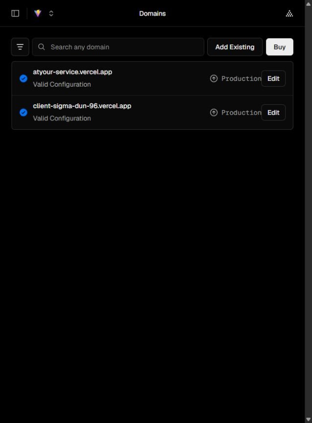
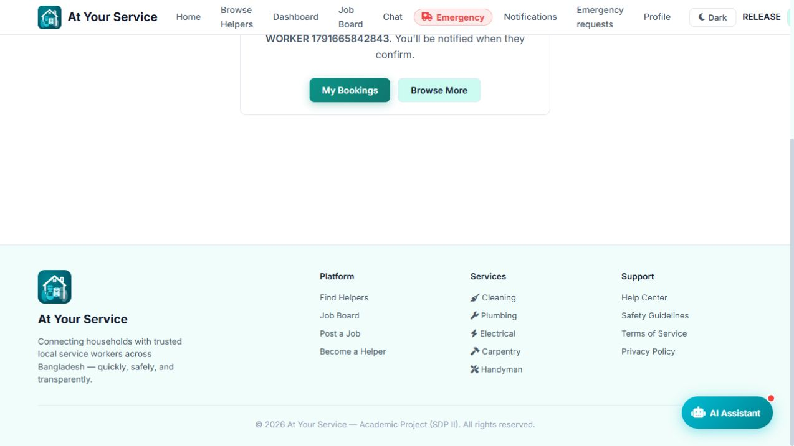

# HelpEarly existing Vercel release — 2026-10-11

**Website deployment completed.** The owner verified that existing project `client` in account `tahmidrk758-3108` is HelpEarly, authorized the domain assignment and deployment, and separately approved official CLI account access. No new project, paid service, domain purchase, transfer or removal was needed. Android UI and application business logic were unchanged.

## Live destinations

- Primary: [https://atyour-service.vercel.app/](https://atyour-service.vercel.app/).
- Secondary retained: [https://client-sigma-dun-96.vercel.app/](https://client-sigma-dun-96.vercel.app/).
- Backend: [https://helpearly-api.onrender.com](https://helpearly-api.onrender.com), existing Render Free service.
- Database: existing Supabase `at-your-service`, schema 2, 22 application tables; media in existing private `helpearly-media` bucket.

Project ID `prj_q363ZytsrXItoeRkbWGAzHI6X9ae`, team `team_CuqUpsKtjRu3tnkaF6GwYy0b`. Both domains show **Production / Valid Configuration**. The earlier account-access report is superseded by the owner's project confirmation and successful domain assignment.

Production environment values are `VITE_API_URL=https://helpearly-api.onrender.com` and `VITE_SOCKET_URL=https://helpearly-api.onrender.com`. Render's shared REST/Socket.IO origin allowlist is `https://atyour-service.vercel.app,https://client-sigma-dun-96.vercel.app`. Configuration-only Render deploy `dep-db5a9bcs728c73cd7nu0` succeeded in 21.8 seconds, reusing application commit `9671e4862820df85bce27a1a91f53c278186e7b1`; remote startup remains read-only. `render.yaml` now matches this verified allowlist.

## Release and executed checks

Vercel deployment `dpl_DNs8jCZVGXz2T1VqTXP86VhPcwmX` built the tracked application snapshot at `e62f82997412d7f369ea9fb430b69eabc3f9dbd2` with existing npm lockfile, Vite 5.4.21 and 104 modules on Vercel's basic build machine. The candidate was uploaded with `--prod --skip-domain` and verified before promotion. No dependency upgrade occurred. Its immutable URL is [client-eu421slwn-tahmidrk758-3108s-projects.vercel.app](https://client-eu421slwn-tahmidrk758-3108s-projects.vercel.app); [deployment dashboard](https://vercel.com/tahmidrk758-3108s-projects/client/DNs8jCZVGXz2T1VqTXP86VhPcwmX).

Hosted JavaScript `/assets/index-DI4o7ysn.js` SHA-256 is `c60ca571e1cae05acda88963566da3914d2a939e60d339248428862a1ae522ac`. Its bytes match the independently built, tested artifact and include the Render API origin. Actual private database URL/password/Storage service key were checked absent. These checks do not constitute an exhaustive secret scan or commercial penetration test.

| Check | Executed result |
|---|---|
| HTTPS, new JS artifact, direct `/login` SPA route | PASS on both domains |
| Domain availability/assignment | PASS, no conflict or transfer |
| API CORS | PASS on both domains; untrusted origin has no allow-origin |
| Authenticated external WebSocket | PASS on both domains; tokenless/untrusted denied |
| Actual live browser registration/login | PASS with disposable household |
| Actual browser manual-service/fee/photo booking | PASS; real database record and signed image byte equality |
| Actual browser logout/login persistence | PASS; booking/photo retained in rendered dashboard |
| Durable worker notification | PASS; database-backed inbox receives booking event |
| Test cleanup and original records | PASS; only two fixture users/associated media removed; original counts/fingerprints match backup |
| Final local configuration and whitespace | PASS: client/server `npm run test:config`, staged `git diff --check`, actual private credential absence and ignored CLI/audit files |
| Job/photo/proposal acceptance, two-way chat, completion/review, admin verification/complaints | Earlier actual Render/Supabase API suite PASS; unchanged backend, not a fresh rendered-browser pass for every workflow |
| Web↔Android API synchronization/reconnect | Earlier actual client-module protocol tests PASS; physical Android pending |
| Live emergency acceptance | PENDING supervised walkthrough; isolated concurrency tests passed; no synthetic alert broadcast to existing workers |
| Real AI answers | PENDING provider credentials; authenticated API correctly returns 503 `AI service has not been configured` |
| Native FCM delivery, signed APK/AAB | PENDING EAS/Firebase configuration, signing and real phone checks |

Evidence: [candidate build](test-results/vercel-production-candidate-20261011.json), [production domains](test-results/vercel-production-domains-20261011.json), [CORS](test-results/vercel-origins-20261011.json), [browser/database/WSS checks](test-results/vercel-ui-protocol-20261011.json), [earlier live MVP](test-results/render-mvp-live-20261011.json).

Local Vercel wrapper attempts failed due a locked Windows esbuild executable and then `spawn cmd.exe ENOENT` in isolation. No app workaround was introduced: direct isolated Vite build and Vercel's actual Linux production build passed instead. The local client dependency directory was safely restored from fresh lockfile installation and client configuration tests passed. A probe assertion mistakenly read the AI error field instead of its documented `message`; corrected probe reran successfully, no app change required. Existing client npm advisories (three moderate, one high) remain for reviewed hardening.

Render Free may sleep after idle traffic; one initial 15-second probe timed out before subsequent readiness succeeded. Open readiness and wait for `ready` before a presentation. Free hosting is not guaranteed emergency delivery or commercial uptime.

## Rollback and backups

Previous Vercel deployment remains available: `AmQuR5rGLqmxCYySXmDahbyWRoEa`, immutable `client-4ebn7go11-tahmidrk758-3108s-projects.vercel.app`. Its previous JS was `/assets/index-C7KjbsDV.js`, SHA-256 `0b45fa3d5ddb7d5245c608d7fd85eb63708fe1c57c7abf81ab1029294a90993d`. Verified pre-release HTML/JS/manifest backup is `H:\apps\HelpEarly-backups\vercel-before-release-e62f829`.

For rollback, open existing `client` → Deployments, select that previous deployment and use Vercel's rollback/promotion control after reviewing the effect. **The old build embeds an obsolete Railway API; reverting to it restores the old frontend but does not restore a functional backend.** Prefer a reviewed rebuild of known-good frontend source with the current Render environment if a functional rollback is needed. Do not restore old SQL over new activity. Preserve both production aliases and the previous deployment.

Database backup and isolated restore evidence: `H:\apps\HelpEarly-backups\supabase-production-2026-10-10T20-01-10-313Z`; it covers public application data before the approved additive migration, with verified empty original Storage inventory. Retain this privately, alongside ignored environment/CA files and existing Git bundles. Copy/encrypt backups offsite. Future activity needs a fresh database/media backup; this pre-migration dump is not a continuous backup.

CLI linkage/OIDC environment files remain ignored; never commit `client/.vercel`, `client/.env.local`, `server/.env.audit`, credentials or future signing keys. Deployment was manual CLI to the existing project, with previous Git linkage untouched. Render auto-deploy remains off. See [free-stack strategy](FREE_STACK_STRATEGY.md) for zero-cost fallback, external configuration steps and commercial migration.

## Phone presentation checks still required

1. Wake Render at `/api/ready`, then open primary website and Android built with `EXPO_PUBLIC_API_URL=https://helpearly-api.onrender.com`.
2. Use your existing household/verified worker accounts; create booking/photo, accept and confirm both screens refresh.
3. Post job/photo, submit/accept proposal, exchange chat, complete booking and submit real review.
4. Logout/login and reconnect network; confirm records/photos remain. Check durable inbox on both clients.
5. Perform emergency acceptance with both apps open under supervision. Configure/test real AI and FCM separately before presenting them as working.

Branding remains deferred; no visual redesign or physical-device pass is claimed.
